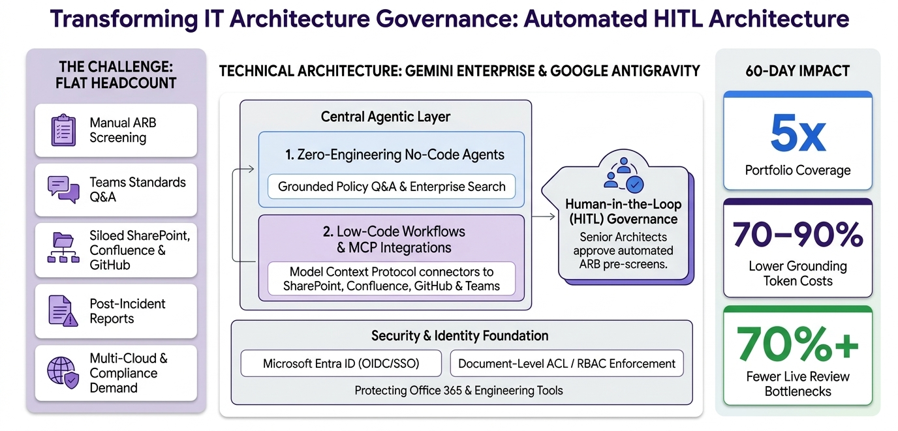

# XPLANE + Tufte 4K Infographic Studio

A conversational Google Antigravity project for turning raw documents and flat presentation slides into **4K (`3840 × 2160`) spatial infographics** grounded in the **XPLANE visual-thinking lineage** (isometric corridors, architectural cutaways, concentric bird's-eye worlds, journey causeways, inhabited 3D mission-control theaters, and kinetic human-operated machinery) and **Edward Tufte's information-design principles**—with a strict **NO SLIDEWARE** guarantee.

---

## Non-Negotiable Output Standards

- **Default 4K UHD Resolution (`3840 × 2160` PNG):** Rendered natively via `google-genai` (`image_size="4K"`) in `render_infographic_4k.py` and verified by a hard 4K gate in `slice_render_for_judge.py promote`.
- **Automatic `assets/logo.png` Brand Integration:** Whenever `assets/logo.png` is present, `render_infographic_4k.py` places that exact image verbatim and proportionally in the reserved masthead corner regardless of what `logo.png` contains—never substituting AI-hallucinated brand icons.
- **100% XPLANE Spatial Storytelling — ZERO SLIDEWARE:** Flat PowerPoint layouts, box-and-arrow block diagrams, and UI dashboard card grids are strictly banned (`Gate 0` in Judge QA). Even when source files in `assets/` are flat slides or tables, the studio translates their facts into an inhabited visual world with illustrated people and workflows.

---

## How It Works

1. **Drop Source Materials into `assets/`:**
   Place whatever pertains to your next infographic—emails (`.eml`/`.msg`), PDFs (`.pdf`), Word docs (`.docx`/`.doc`), Excel sheets (`.xlsx`/`.csv`), PowerPoint decks (`.pptx`), notes (`.md`/`.txt`), or screenshots/diagrams (`.png`/`.jpg`/`.webp`)—directly into `assets/`.
   - `assets/XPLANE/` stays permanently in place as the **read-only visual style canon** and is automatically excluded from topic content extraction.
2. **Start a Conversation in Antigravity Chat:**
   Ask for an infographic (defaulting to **`3840 × 2160` `16:9` 4K PNG** unless you specify another aspect ratio or size).
   - **Checkpoint 1 (Concept & Style Pitch):** An **Infographics Specialist** (running on another high-reasoning model different from the active primary orchestrator, such as a Flash or Pro model with high reasoning enabled) digests `assets/` and pitches 2–3 XPLANE spatial concepts across `S1`–`S16`.
   - **Behind-the-Scenes 4K Render + 1:1 Zoom Judge QA:** `render_infographic_4k.py` generates a `3840 × 2160` 4K PNG, slices it into **9 overlapping 1:1 full-resolution tiles**, and audits it via an independent **LLM Judge** (`Gate 0` Anti-Slideware & 4K + `Gate A` Borders/Washes + `Gate B` 100% Legibility).
   - **Checkpoint 2 (Art-Direction Iteration):** Approved 4K renders are saved with timestamps in `deliverables/` (`YYYYMMDD-HHMMSS-<topic-slug>.png`) alongside a Judge QA scorecard.

### Examples Included

This is a single example of a slide image `asset/` that we can enhance narratively with this project.  You can add as many assets as you want to support the infographic narrative.

<h4>Source asset: sample_asset_delete_use_yours.webp</h4>

<p>
  <a href="assets/sample_asset_delete_use_yours.webp" target="_blank" rel="noopener noreferrer">
    
  </a>
</p>
<br />

Once your assets are in the `assets/` folder, just prompt `Make me version S2` and the project will generate the default 4K infographic in the S2 style based on what was put in the `assets/` directory.

<br />

<h4>Style S1 - Isometric Cutaway</h4>
<p>
  <a href="deliverables/%28sample%20you%20can%20delete%29%20s1-isometric-cutaway-governance.png" target="_blank" rel="noopener noreferrer">
    
  </a>
</p>
<br />

<h4>Style S2 - Concentric Bird's-Eye Ecosystem</h4>
<p>
  <a href="deliverables/%28sample%20you%20can%20delete%29%20s2-concentric-ecosystem-governance.png" target="_blank" rel="noopener noreferrer">
    
  </a>
</p>
<br />

<h4>Style S3 - Inhabited 3D Mission-Control Room</h4>
<p>
  <a href="deliverables/%28sample%20you%20can%20delete%29%20s3-mission-control-governance.png" target="_blank" rel="noopener noreferrer">
    
  </a>
</p>
<br />

<h4>Style S4 - Kinetic Flat-Vector Machinery</h4>
<p>
  <a href="deliverables/%28sample%20you%20can%20delete%29%20s4-kinetic-machinery-governance.png" target="_blank" rel="noopener noreferrer">
    
  </a>
</p>
<br />

<h4>Style S5 - Editorial Ink &amp; Watercolor Journey</h4>
<p>
  <a href="deliverables/%28sample%20you%20can%20delete%29%20s5-watercolor-journey-governance.png" target="_blank" rel="noopener noreferrer">
    
  </a>
</p>
<br />

<h4>Style S6 - Architect's Vellum Blueprint</h4>
<p>
  <a href="deliverables/%28sample%20you%20can%20delete%29%20s6-vellum-blueprint-governance.png" target="_blank" rel="noopener noreferrer">
    
  </a>
</p>
<br />

<h4>Style S7 - Kinetic Pop-Line &amp; Tatami-Room Cutaway</h4>
<p>
  <a href="deliverables/%28sample%20you%20can%20delete%29%20s7-tatami-pop-governance.png" target="_blank" rel="noopener noreferrer">
    
  </a>
</p>
<br />

<h4>Style S8 - Ligne Claire Architectural Comic</h4>
<p>
  <a href="deliverables/%28sample%20you%20can%20delete%29%20s8-ligne-claire-governance.png" target="_blank" rel="noopener noreferrer">
    
  </a>
</p>
<br />

<h4>Style S9 - Illustrated Encyclopedia Cross-Section</h4>
<p>
  <a href="deliverables/%28sample%20you%20can%20delete%29%20s9-encyclopedia-cutaway-governance.png" target="_blank" rel="noopener noreferrer">
    
  </a>
</p>
<br />

<h4>Style S10 - Symmetrical Dollhouse Elevation</h4>
<p>
  <a href="deliverables/%28sample%20you%20can%20delete%29%20s10-dollhouse-elevation-governance.png" target="_blank" rel="noopener noreferrer">
    
  </a>
</p>
<br />

<h4>Style S11 - Mid-Century Modern Minimal Realism</h4>
<p>
  <a href="deliverables/%28sample%20you%20can%20delete%29%20s11-midcentury-screenprint-governance.png" target="_blank" rel="noopener noreferrer">
    
  </a>
</p>
<br />

<h4>Style S12 - 1960s Apollo Technical Cutaway Manual</h4>
<p>
  <a href="deliverables/%28sample%20you%20can%20delete%29%20s12-apollo-cutaway-governance.png" target="_blank" rel="noopener noreferrer">
    
  </a>
</p>
<br />

<h4>Style S13 - Isometric Risograph Editorial Zine</h4>
<p>
  <a href="deliverables/%28sample%20you%20can%20delete%29%20s13-risograph-zine-governance.png" target="_blank" rel="noopener noreferrer">
    
  </a>
</p>
<br />

<h4>Style S14 - Victorian Steampunk Clockwork Cutaway</h4>
<p>
  <a href="deliverables/%28sample%20you%20can%20delete%29%20s14-steampunk-clockwork-governance.png" target="_blank" rel="noopener noreferrer">
    
  </a>
</p>
<br />

<h4>Style S15 - Botanical Watershed &amp; Living Ecosystem</h4>
<p>
  <a href="deliverables/%28sample%20you%20can%20delete%29%20s15-botanical-watershed-governance.png" target="_blank" rel="noopener noreferrer">
    
  </a>
</p>
<br />

<h4>Style S16 - Clean-Line Wimmelbilder Ultra-Intricate Cutaway</h4>
<p>
  <a href="deliverables/%28sample%20you%20can%20delete%29%20s16-wimmelbilder-intricate-governance.png" target="_blank" rel="noopener noreferrer">
    
  </a>
</p>

---

## Sixteen XPLANE Style Presets (`S1`–`S16`)

Defined in full in [docs/STYLE_GUIDE.md](docs/STYLE_GUIDE.md):

| Preset | Style Pole | XPLANE Spatial World & Feel |
|---|---|---|
| **`S1`** | Ultra-Clean / Pixel-Perfect Vector | **Precision Isometric Cutaway Corridor & Stepped Platforms** — crisp 30° axonometric campus/corridors, open cutaway rooms, floor-plane KPIs, frameless margin callouts |
| **`S2`** | Clean Spatial Ecosystem Poster | **Concentric Bird's-Eye Ecosystem World & Ring Map** — elevated 3D concentric island/city populated with landmarks, actors, and clean editorial columns |
| **`S3`** | Spatial Command Storytelling | **Inhabited 3D Mission-Control Room & Panoramic Launch Stage** — illustrated operators at physical 3D consoles watching a wall-mounted trajectory launch screen |
| **`S4`** | Kinetic Mechanical Metaphor | **Kinetic Flat-Vector Machinery, Gears & Refinery Ribbons** — interlocking gears, pulleys, sorting funnels, and conveyor belts operated by stylized people |
| **`S5`** | Organic / Hand-Drawn & Finished | **Editorial Ink & Watercolor Transformation Journey** — fountain-pen linework, warm watercolor washes, bottleneck swamp to sunlit value-realization causeway |
| **`S6`** | Tactile Draftsman Cutaway | **Architect's Vellum Cross-Section & Spot-Marker Blueprint** — fine-liner & graphite architectural cutaway on warm cream vellum with two-color flow highlights |
| **`S7`** | Vibrant Flat-Pop Architectural Collage | **Kinetic Pop-Line & Cascading Tatami-Room Cutaway** — Yusuke Nakamura / Masaaki Yuasa sleek black ink contours & bold unshaded pop-color room cascades on warm cream paper |
| **`S8`** | Uniform Ink & Flat Cel Color | **Ligne Claire Architectural Comic** — Hergé / Joost Swarte / Chris Ware uniform black contours, zero hatching/gradients, luminous flat cel isometric cutaway campus |
| **`S9`** | Pen-and-Ink Cutaway Anatomy | **Illustrated Encyclopedia Cross-Section** — Macaulay / Biesty intricate pen-and-ink citadel & subterranean vaults with muted washes on open ivory encyclopedia margins |
| **`S10`** | Orthographic Frontal Cutaway | **Symmetrical Dollhouse Elevation** — Wes Anderson deadpan 100% orthographic room-by-room frontal cutaway in curated mid-century pastels over a subterranean vault |
| **`S11`** | Geometric Screenprint Ecosystem | **Mid-Century Modern Minimal Realism** — Charley Harper / Saul Bass flat geometric shapes, cardinal & 45° trajectories, and serigraph ink texture on warm cream stock |
| **`S12`** | Retro-Futuristic Engineering Gouache | **1960s Apollo Technical Cutaway Manual** — NASA / JPL / Popular Science sliced titanium-and-enamel command module & subterranean launch bay on stark white engineering paper |
| **`S13`** | Spot-Ink Overprint Isometric World | **Isometric Risograph Editorial Zine** — crisp 30° isometric workshop & stepped causeway in 3 spot soy inks (deep navy, fluorescent coral, bright teal) with tactile Risograph grain |
| **`S14`** | Industrial Brass & Copper Engine-House | **Victorian Steampunk Clockwork & Pneumatic Cutaway** — Jules Verne / Babbage fine-liner etching with burnished brass gear-trains, verdigris copper pneumatic tubes, and steam gauges floating in clean parchment margins |
| **`S15`** | Naturalist Field-Guide Cross-Section | **Botanical Watershed & Living Permaculture Ecosystem** — Alexander von Humboldt pen-and-ink + watercolor ecological cross-section from terraced reed-bed bio-filters and sliced limestone aquifer to thriving orchard harvest |
| **`S16`** | Ultra-Intricate Macro-Clean Isometric World | **Clean-Line Wimmelbilder & Horological Micro-Detail Cutaway** — IC4DESIGN / Swiss horological 0.25pt isometric micro-worlds floating in `35%+` pure gallery-white (`#FFFFFF`) negative space with non-verbal geometric interior micro-detail |

---

## Repository Structure

```text
├── AGENTS.md                                      # Always-on Antigravity studio invariants (Zero Slideware + 4K)
├── assets/                                        # Drop current project source files & optional logo.png here
│   └── XPLANE/                                    # Permanent read-only XPLANE reference library (excluded from source intake)
├── deliverables/                                  # Timestamped 4K outputs (YYYYMMDD-HHMMSS-<slug>.png, default 3840x2160)
├── docs/
│   ├── STYLE_GUIDE.md                             # Canonical XPLANE + Tufte Style & Craft Guide
│   └── anti-patterns/                             # Real defect crops used to calibrate Judge Gate A
├── tests/                                         # Automated pytest suite for ingestion, 4K rendering, slicing & rules
└── .agents/
    ├── agents/                                    # Specialist & independent LLM Judge definitions (Gate 0 + Gate A + Gate B)
    └── skills/xplane-infographic-studio/          # Studio orchestration skill & 4K Python utilities
```

## Running Verification Tests

```bash
python3 -m pytest -v
```
